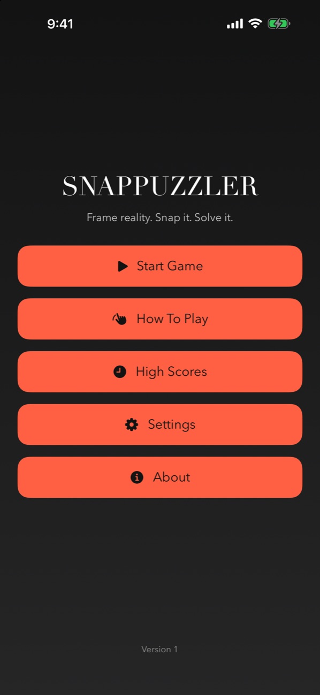
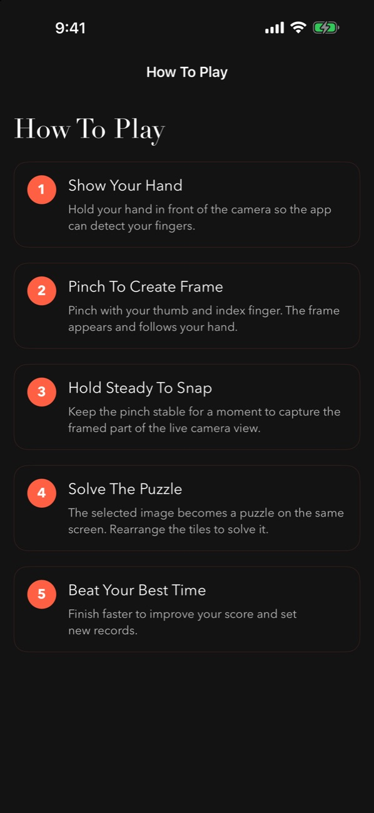
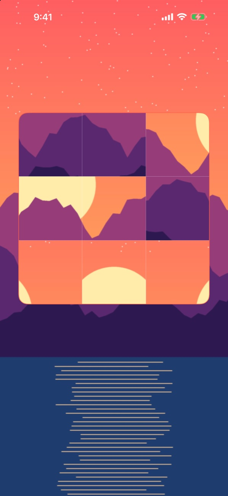

<div align="center">

# SNAPPUZZLER

**Frame reality. Snap it. Solve it.**

*A live-camera puzzle game for iPhone. Pinch your fingers to frame any part of the real world, hold still to snap it, and race the clock to unscramble it.*


&nbsp;&nbsp;
&nbsp;&nbsp;


<sub>Right: a 3×3 puzzle built from a snapped frame (demo scene, rendered in the simulator)</sub>

</div>

---

## The idea

Jigsaw apps hand you stock photos. SNAPPUZZLER turns **whatever's in front of you** (your desk, a skyline, a friend's face) into the puzzle. There are no buttons to press and no photo library to dig through: your hand is the controller.

## How you play

| | Step | What happens |
|---|---|---|
| ✋ | **Show your hand** | Apple Vision tracks your fingers live, drawn as a skeleton overlay on the camera feed. |
| 🤏 | **Pinch to frame** | Pinch thumb and index finger to draw a square frame that follows your hand. |
| 📸 | **Hold steady to snap** | Keep the pinch still for a moment and the framed region is captured from the live camera. |
| 🧩 | **Solve on the spot** | The snap is sliced into a shuffled grid right where you framed it. Tap two tiles to swap them. |
| ⏱️ | **Beat your best** | A timer and move counter run until the image is whole again, and your best time is saved. |

## Features

- **Gesture-only capture** using Vision hand-pose detection and pinch-distance tracking, with no shutter button.
- **Same-screen puzzles.** The frozen camera frame stays in the background, so you solve the puzzle in context.
- **Three difficulty levels:** 3×3, 4×4 and 5×5 grids.
- **High scores** with best time and move count per grid size, saved on device.
- **Settings** for the default grid size, the capture hold duration, haptics and sound.
- **Front or back camera** with one-tap switching.
- **Dark neon-coral theme** with a custom serif wordmark, built on a shared `Theme`.

## Architecture

A clean **MVVM + services** layout:

```
SnapPuzzler/
├── App/          RootView, Theme, app entry
├── Models/       PuzzleBoard, PuzzleTile, FrameRect, HandPoint, GameMode, HighScore…
├── ViewModels/   GameViewModel, HomeViewModel, HighScoresViewModel, SettingsViewModel
├── Views/        Home, Game, HowToPlay, HighScores, Settings, About
├── Components/   PuzzleBoardView, HandOverlayView, FrameOverlayView, ScoreCard…
└── Services/     CameraService, HandTrackingService, FrameCaptureService,
                  PuzzleImageSlicerService, ScoreStorageService, SettingsStorageService
```

- **CameraService** runs the `AVCaptureSession` and handles permissions and camera switching.
- **HandTrackingService** turns Vision hand-pose results into normalized hand points and bone connections.
- **FrameCaptureService** grabs the latest sample buffer, orients it, and crops it to the framed region.
- **PuzzleImageSlicerService** cuts the snap into an N×N shuffled `PuzzleBoard`.

## Getting started

1. Clone the repo and open `SnapPuzzler.xcodeproj` in Xcode 26.
2. Run on a **physical iPhone**. Hand tracking needs a real camera, so the simulator can only show the menus.
3. Allow camera access when prompted.

## About

Designed and built by **Roszhan Raj**.
